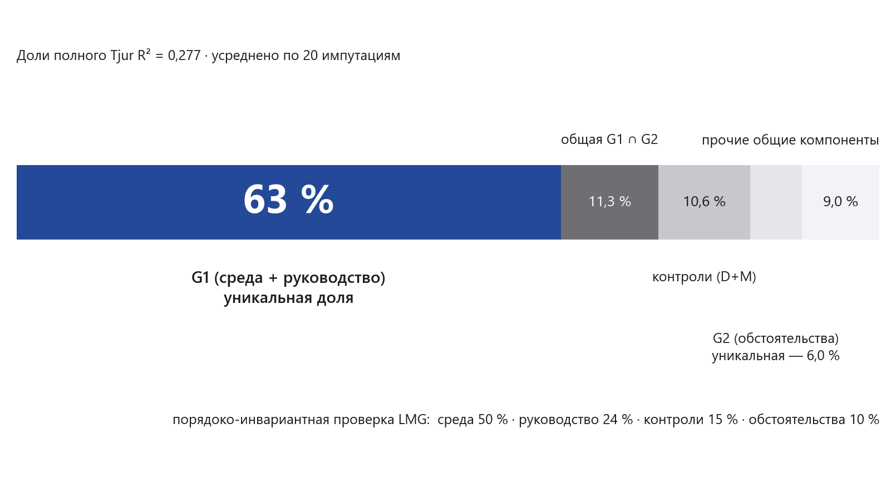
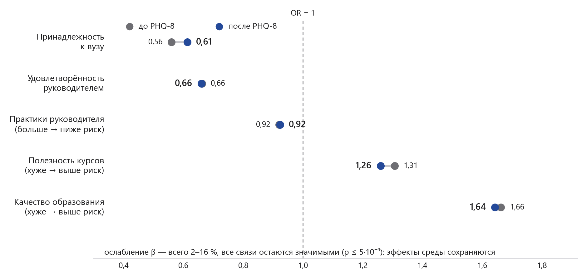
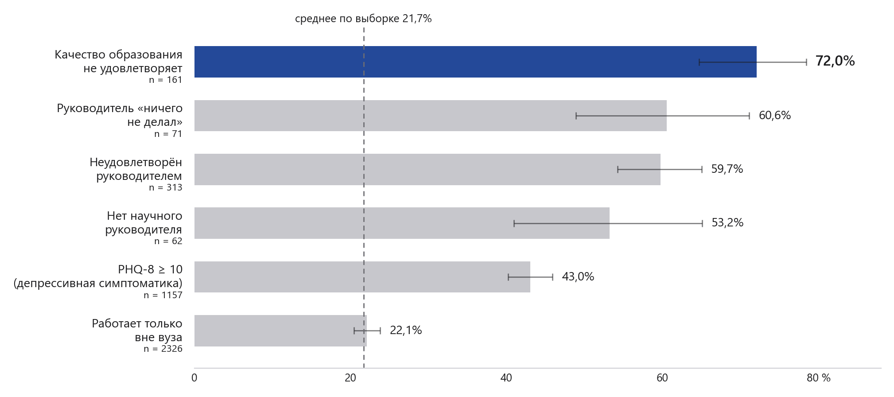

# Что приводит аспиранта к мысли об отчислении: среда или обстоятельства?

Анализ всероссийского опроса аспирантов (ИО ВШЭ, 2021, N = 5007, 248 вузов): декомпозиция факторов намерения бросить аспирантуру на две соревнующиеся группы — образовательная среда и научное руководство против жизненных обстоятельств — с честной оценкой той части объяснённой вариации, которую между группами разделить нельзя.

Проект сделан в рамках хакатона исследователей высшего образования (ИВО-2026, НИУ ВШЭ, Институт образования), номинация «Анализ данных», задача 1. Индивидуальное участие; презентация решения — в `presentation/`.

> **In short (EN):** Using a national survey of 5007 doctoral students at 248 Russian universities (HSE Institute of Education, 2021), I decompose the intention to drop out of a PhD program into two competing factor groups — institutional environment & supervisor (G1) vs life circumstances (G2) — with commonality analysis over all 15 submodels of a hierarchical logistic regression (Tjur R² decomposition, invariant to block entry order) and 20 MICE imputations. G1 explains a unique 63% of the full model R² vs 6% for G2; the inseparable overlap is 11%. Effects survive ordered-logit robustness, cluster-robust and multilevel checks (ICC ≈ 2–3%), and adjustment for PHQ-8 depression scores. Full pipeline in Python (pandas, statsmodels, scikit-learn), reproducible end-to-end.

## Главный результат

Каждый пятый аспирант (21,7%) склонен бросить обучение. Декомпозиция Tjur R² = 0,277 полной модели (n = 4569, событий 972; пулинг по 20 MICE-импутациям):



* **63%** объяснённой вариации — уникальный вклад образовательной среды и научного руководства (G1).
* **6%** — уникальный вклад жизненных обстоятельств (G2: занятость, доход, семья, ковидные трудности).
* **11,3%** — общая компонента G1∩G2: эта часть на данных неразделима — честный ответ на вопрос «можно ли отделить группы факторов» (в основном да: неразделимая часть в 5,6 раза меньше уникальной доли G1).
* Порядоко-инвариантная проверка LMG даёт тот же вывод: среда 50% + руководство 24% против 10% у обстоятельств.

Декомпозиция инвариантна к порядку ввода блоков и посчитана собственным перебором всех 15 непустых подмоделей (2⁴ − 1 блока) на каждом из 20 импутированных датасетов — 300 логистических регрессий; сумма всех компонент сходится к R² полной модели с точностью до машинного эпсилон (санити-чек в скрипте).

## Данные

Всероссийский опрос аспирантов Института образования ВШЭ, пандемийная волна 2021 года: 5007 респондентов, 276 переменных, 248 вузов. Сам массив в репозиторий не включён — данные предоставлены участникам хакатона и не являются моими для распространения; описание и порядок получения — в [data/README.md](data/README.md). Всё остальное воспроизводится end-to-end.

## Методы

Пайплайн (все шаги — скрипты в `analysis/`, протоколы — в `reports/`):

1. **Очистка данных** — коды отказов 98/99 в NA только по подтверждённым меткам .sav (содержательные коды 99, например «Македония» или реальный вуз с кодом 99, не тронуты); структурные пропуски-фильтры анкеты разрешены явными правилами кодирования и никогда не импутируются; восстановлена логически детерминированная часть пропусков (основная цель поступления у одноцелевых — 1290 чел.). 12/12 автоматических проверок PASS, включая независимую перепроверку по исходному .sav: [validation_report.md](reports/validation_report.md), [codebook.md](reports/codebook.md).
2. **Описательный портрет** рискующего уйти, доли с 95% ДИ Вильсона + внемодельная проверка валидности целевой через самооценку шансов защиты: [descriptives_report.md](reports/descriptives_report.md).
3. **Множественная импутация** цепными уравнениями (m = 20, только item nonresponse, ручной пулинг по Рубину): [models_hier_report.md](reports/models_hier_report.md).
4. **Иерархическая блочная логистическая регрессия** D+M → L → E → S (62 параметра, EPV = 15,7) с лестницей приростов R² и AIC.
5. **Commonality-анализ** по блокам (заголовочный результат, см. выше) + **dominance-анализ (LMG)** как порядоко-инвариантная перекрёстная проверка: [models_decomp_report.md](reports/models_decomp_report.md).
6. **Робастность:** порядковая логит-модель на исходной 4-балльной шкале (рейтинг блоков тот же), complete-case (теряет 31% и именно «проблемных» — показано), полная выборка с дамми «нет руководителя», кластерно-робастные SE по вузу и многоуровневая модель (ICC ≈ 2–3% — «эффект среды» не артефакт кластеризации), расширенная спецификация с PHQ-8.

## Гипотезы и вердикты

| Гипотеза | Содержание | Вердикт |
|---|---|---|
| H1 | Среда и руководство весят больше обстоятельств | **Подтверждена**: 63% vs 6% уникальной доли; оба порядоко-инвариантных критерия согласны |
| H2 | Обстоятельства не сводятся к нулю: у работающих связь работы с диссертацией снижает риск | **Подтверждена частично**: факт работы риска не добавляет (22,1% ≈ среднему 21,7%), но у работающих чем прочнее связь с темой, тем ниже риск — OR 0,87 (вне вуза) и 0,88 (в вузе) за балл шкалы |
| H3 | Депрессивная симптоматика (PHQ-8) перехватывает часть связи среды с намерением | **Не подтверждена в сильной форме**: PHQ-8 добавляет +0,042 R² и забирает 23% уникальной доли G1, но индивидуальные эффекты среды ослабевают лишь на 2–16% и остаются значимыми (p ≤ 5·10⁻⁴) |
| H4 | Эффект руководителя сильнее у поступавших «в науку» | **Не подтверждена**: взаимодействие незначимо (p = 0,33) |



## Портрет риска



Первые четыре строки — качество программы и руководитель. Работа вне вуза сама по себе риска не добавляет: 22,1% против среднего по выборке 21,7% — «быт» без проблем со средой почти безопасен, проблемная среда почти всегда рискованна.

## Презентация

Итоговая презентация решения (10 слайдов, как требовал регламент хакатона):

* [pitch_hse_ivo_2026.pdf](presentation/pitch_hse_ivo_2026.pdf) — для быстрого просмотра
* [pitch_hse_ivo_2026.pptx](presentation/pitch_hse_ivo_2026.pptx) — исходник
* [slides/](presentation/slides/) — PNG каждого слайда

## Структура репозитория

```
├── README.md                  — этот файл
├── analysis/                  — воспроизводимый пайплайн (Python)
│   ├── prep_data.py           — очистка .sav → аналитический датасет (+ кодбук и валидация)
│   ├── descriptives.py        — описательный портрет с ДИ Вильсона
│   ├── models_hier.py         — MICE m=20 + иерархическая блочная логистическая регрессия
│   ├── models_decomp.py       — commonality-декомпозиция (15 подмоделей × 20 импутаций) + LMG
│   ├── profiles.py            — профили риска (предсказанные вероятности)
│   ├── figures_final.py       — все фигуры проекта
│   └── *_results.json         — полные численные результаты (все коэффициенты, обе лестницы)
├── docs/
│   └── solution_design.md     — паспорт решения: вопрос, гипотезы, дизайн, обоснование методов
├── reports/                   — протоколы анализа
│   ├── codebook.md            — кодбук производных переменных
│   ├── validation_report.md   — 12/12 проверок чистки данных
│   ├── descriptives_report.md — описательный анализ
│   ├── models_hier_report.md  — импутация и лестница моделей
│   ├── models_decomp_report.md— декомпозиция вкладов, PHQ-8, многоуровневая робастность
│   └── literature_review.md   — обзор литературы (41 источник, DOI проверены)
├── figures/                   — фигуры проекта (рендерятся figures_final.py)
├── presentation/              — итоговая презентация (pdf, pptx, PNG слайдов)
└── data/                      — только README: описание массива и порядок получения
```

## Воспроизведение

```bash
pip install -r requirements.txt
# 1. Положить Аспиранты_массив.sav в data/01 Всероссийский опрос аспирантов/
#    (см. data/README.md — массив выдаётся ИО ВШЭ)
python analysis/prep_data.py        # → analysis/aspirants_clean.* + reports/{codebook,validation_report}.md
python analysis/descriptives.py     # → reports/descriptives_report.md
python analysis/models_hier.py      # → analysis/mice_imputations.parquet + reports/models_hier_report.md
python analysis/models_decomp.py    # → reports/models_decomp_report.md (запуск по частям: part4, part6, part7, part8, rob_*)
python analysis/profiles.py         # → analysis/profiles.json
python analysis/figures_final.py    # → figures/fig1..fig7.png
```

Скрипты воспроизводимы как есть: все пути относительные, «магические числа» вынесены в константы в шапке файлов. Полный прогон — минуты на обычном ноутбуке.

## Технологии

Python 3 · pandas · numpy · pyreadstat (чтение .sav) · statsmodels (логит, ordered logit, кластерно-робастные SE) · scikit-learn (IterativeImputer) · scipy · matplotlib.

## Ограничения

Кросс-секция (причинный порядок недоказуем), самоселекция и отсутствие весов (уровни — не популяционные оценки), единый источник self-report (common method bias), намерение ≠ факт отчисления, пандемийная специфика 2021 года. Подробно и честно — в [docs/solution_design.md](docs/solution_design.md), раздел «Главные ограничения и риски дизайна».

## Лицензия и авторство

Код — [MIT](LICENSE). Данные не включены и лицензии не подпадают (принадлежат ИО ВШЭ). Обзор литературы и отчёты — можно цитировать с указанием автора.

Автор: **Дорофеев Арсений**, бакалавр «Sociology and Social Informatics», НИУ ВШЭ (Санкт-Петербург). Контакты — в профиле GitHub.
